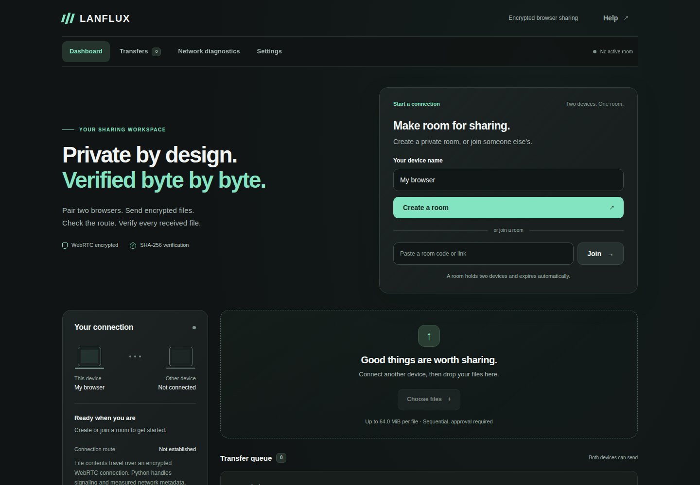
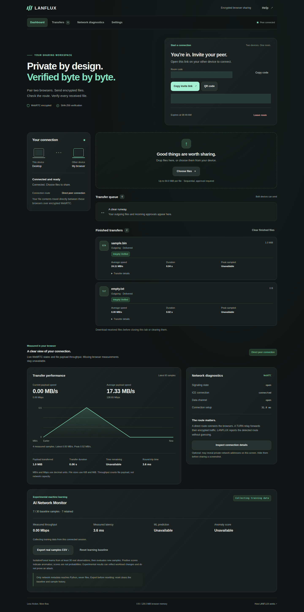
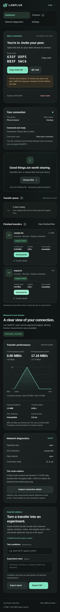
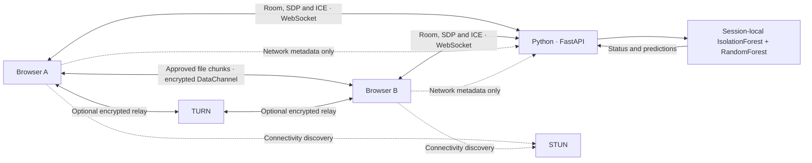
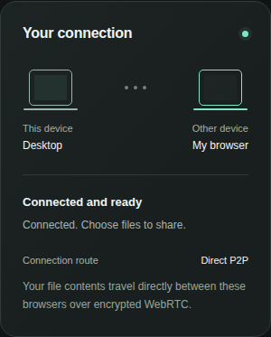
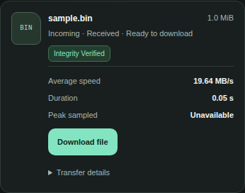
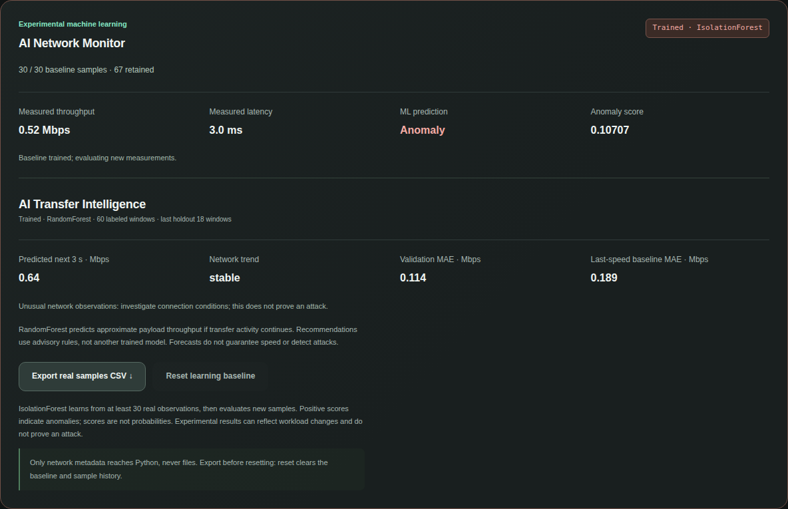
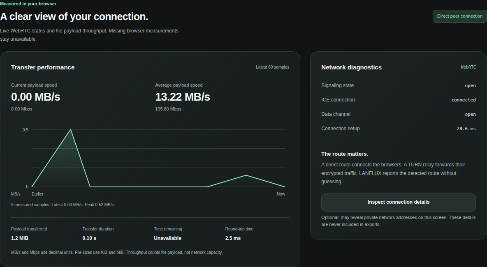

<div align="center">


# LANFLUX

### AI-Powered Peer-to-Peer File Sharing

**Share between browsers. Verify every file. Observe the network.**

[](https://github.com/kasim672/LanFlux/actions/workflows/ci.yml)
[](CHANGELOG.md)
[](requirements.txt)
[](#architecture)
[](docs/AI_MONITOR.md)

[Quick start](#quick-start) · [Phone pairing](#pair-your-phone) · [Documentation](docs/README.md) · [PDF technical report](docs/LANFLUX_Technical_Report.pdf)

</div>



## Overview

LANFLUX connects two browsers through an encrypted WebRTC DataChannel. Create a temporary room, scan its QR invitation, approve a file, and download the verified result. Either device can send; no desktop app, account or frontend build is required.

Python handles room management, signaling and experimental network analysis. **File contents, filenames and SHA-256 digests stay between browsers.** The AI monitor learns from real session measurements, flags unusual observations and predicts approximate near-future throughput. It does not inspect files or control transfers.

## Features

| Sharing | Trust and visibility |
| --- | --- |
| Room codes, matching QR/copy invitations and automatic link joining | Explicit receiver approval before any file payload |
| Bidirectional sharing with independent sequential queues | Incremental SHA-256 over original and received bytes |
| Desktop drag-and-drop and mobile file selection | Clear verified, rejected, cancelled and failed states |
| Chunked transfers with DataChannel backpressure | Measured throughput, RTT and connection state |
| Downloads and bounded in-memory retention | Direct/TURN labels based on observed ICE statistics |
| Responsive dark interface and keyboard-accessible controls | IsolationForest anomaly detection, RandomForest forecasts and real-data CSV export |

### Desktop and mobile

<table>
  <tr>
    <td width="76%"></td>
    <td width="24%"></td>
  </tr>
</table>

These screenshots come from real Chromium/WebRTC scenarios. Room capabilities and invitation addresses are masked; measured values and transfer results are unchanged. The mobile image demonstrates a browser viewport, not a physical-phone test.

## Architecture



The server validates signaling and pairs at most two peers per temporary room. Browsers exchange an offer, answer and ICE candidates, then open a reliable, ordered DataChannel. STUN helps discover connectivity. When required, TURN relays encrypted WebRTC traffic; Python still does not receive file data. The route stays **Unavailable** until statistics support a direct or relay classification.

## File-sharing workflow

1. **Create** a room and share its code, link or QR invitation.
2. **Join** from another browser. Invitation links automatically join the specified room.
3. **Select** files. LANFLUX incrementally hashes each original file.
4. **Approve** the incoming offer on the receiving device, or reject it.
5. **Transfer** bounded chunks while observing progress and real throughput.
6. **Verify and download** after the receiver checks the exact byte count and SHA-256 digest.





Both peers can cancel. Leaving, reloading or a broken connection stops unfinished transfers cleanly. Select the file again to restart; automatic resume is not implemented.

## AI Network Monitor



Open **Network diagnostics → AI Network Monitor** after pairing. LANFLUX collects actual payload throughput in decimal **Mbps**, DataChannel ping/pong **RTT in ms**, active-transfer state and observed route approximately once per second. Files, names, hashes and private ICE addresses never enter the ML API.

| Component | Learning requirement | What it shows |
| --- | --- | --- |
| IsolationForest | 30 real observations, 25 server-measured seconds and feature variation | Normal/Anomaly and a signed anomaly score on later observations |
| RandomForestRegressor | 60 genuinely labeled active-transfer windows, sufficient variation and disjoint chronological train/validation data | Approximate throughput over the next three seconds, model MAE and last-speed baseline MAE |
| Transfer advisor | Fresh forecast and observed anomaly state | Improving/stable/degrading trend and clearly identified advisory rules |

The forecast uses five past observations. Its target comes only from subsequent measured intervals. Idle periods, missing measurements and irregular sampling do not create training successes. **Learning from network activity** is expected until enough eligible data exists. Predictions are experimental, may be worse than the simple baseline and never alter the transfer engine.

### Demonstrate it

1. Pair two foreground browsers and send representative files with receiver approval.
2. IsolationForest usually needs at least 30–45 seconds. Forecast learning needs roughly 70–90 seconds of sustained, varied **active** transfer observations; short files and idle time may take much longer.
3. During continued activity, compare measured and predicted Mbps, trend, model MAE and baseline MAE. Do not describe MAE as an accuracy percentage.
4. Choose **Export real samples CSV** before disconnecting or resetting. Evaluate the anomaly detector's chronological holdout with:

```bash
python -m aiml.evaluate /path/to/lanflux-network.csv --output network-predictions.csv
```

The CLI evaluates IsolationForest only; RandomForest validation is calculated live and included in CSV columns. Neither path fabricates data. Reset, peer replacement and disconnect clear session-local models. A positive anomaly score denotes unusual observations, not proof of an attack. No performance improvement or labeled anomaly accuracy is claimed.

See the [complete AI methodology and demonstration](docs/AI_MONITOR.md), [reproducible network experiments](docs/NETWORK_EXPERIMENTS.md) and [detailed PDF report](docs/LANFLUX_Technical_Report.pdf). The screenshot shows a real controlled loopback transfer with test-only pacing, not a general Wi-Fi benchmark.

## Technology stack

| Layer | Implementation |
| --- | --- |
| Server | Python 3.10+, FastAPI, Uvicorn and WebSockets |
| Browser | HTML, CSS and native JavaScript; no frontend framework |
| Transport | WebRTC RTCPeerConnection and RTCDataChannel; optional STUN/TURN |
| Integrity | Pinned, licensed @noble/hashes incremental SHA-256 |
| AI/ML | scikit-learn IsolationForest and RandomForestRegressor; session-local real observations |
| Verification | pytest, Node test runner and Playwright Chromium |

## Quick start

```bash
git clone https://github.com/kasim672/LanFlux.git
cd LanFlux
```

**Linux / macOS**

```bash
python3 -m venv .venv
source .venv/bin/activate
python -m pip install -r requirements.txt
python -m lanflux
```

**Windows PowerShell** — activation is optional:

```powershell
py -3 -m venv .venv
.\.venv\Scripts\python.exe -m pip install -r requirements.txt
.\.venv\Scripts\python.exe -m lanflux
```

Open **http://localhost:8000**. The default listens on the computer only. Health endpoint: **http://localhost:8000/health**. Node/npm is required only for development tests, not for running LANFLUX.

## Pair your phone

Start the server with explicit local-network access:

```bash
python -m lanflux --lan --port 8000
```

On Windows, use `.\.venv\Scripts\python.exe -m lanflux --lan --port 8000`.

1. Connect the computer and phone to the same trusted Wi-Fi and keep both tabs foregrounded.
2. Open **http://localhost:8000** on the computer and create a room.
3. Scan the QR invitation on the phone. LANFLUX discovers a physical adapter's private IPv4 address and preserves the port; Docker, VPN and virtual adapters are excluded. QR, Copy Link and the displayed URL use the same invitation.
4. The phone automatically joins. Wait for **Connected and ready**, then send a file and approve it on the other device.
5. Download the verified file and repeat in the reverse direction.

Allow Python/port 8000 through the firewall on private networks. If adapter discovery is unavailable or another physical network is selected, copy `.env.example` to `.env`, set `LANFLUX_PUBLIC_URL` to your actual browser-reachable origin, restart, and create a new room. Opening the computer's LAN URL before creating a room also preserves that origin. No LAN address is hardcoded.

Local HTTP works where the browser exposes WebRTC; hashing does not require Web Crypto. Use **HTTPS/WSS** for untrusted networks and internet deployment. Public hosting requires a reverse proxy, exact trusted origins, one Python worker and, for restrictive networks, a suitable TURN relay. TURN credentials can be issued with a short lifetime using a server-held coturn signing secret. Relay quotas and authenticated public access remain operator responsibilities. See [configuration](docs/CONFIGURATION.md) and the [HTTPS/WSS + coturn deployment guide](docs/DEPLOYMENT.md).

## Restricted college Wi-Fi

Keep `LANFLUX_ICE_TRANSPORT_POLICY=all` for native ICE selection: reachable direct candidates remain preferred, with configured TURN alternatives available. Administrators can supply UDP/TCP TURN and **TURN over TLS/TCP on port 443** through `LANFLUX_TURN_URLS`. Public `/api/config` contains no relay passwords; admitted room peers receive fresh credentials on each pairing. For coturn, `LANFLUX_TURN_SHARED_SECRET` enables expiring HMAC credentials without exposing the signing secret to browsers.

Network diagnostics shows **Direct P2P**, **TURN Relay**, **Connecting** or **Failed**; unsupported selected-pair statistics remain **Unavailable**. Safe ICE error summaries distinguish server reachability reports and authentication challenges without exposing private addresses. A configured relay is not proof that it was selected or is reachable.

For use beyond the laptop's LAN, deploy FastAPI behind an authenticated HTTPS reverse proxy and configure a public invitation origin. Users then open the public HTTPS URL; laptop port 8000 is unnecessary. The [deployment guide](docs/DEPLOYMENT.md) includes Nginx, systemd and coturn templates, certificate/port requirements, relay quotas and a verification checklist.

**You must provide** public hosting, DNS, valid web/TURN certificates, relay credentials and firewall rules. TURN TLS is not HTTPS: port 443 may still be blocked by protocol filtering, captive portals or an HTTP-only proxy. Use an IT-approved configuration or network; this feature does not bypass college policy. Local `--lan` mode remains available.

## Network diagnostics and integrity



Diagnostics shows signaling, ICE and DataChannel states; observed direct/TURN routing; setup time; current/average throughput; transferred bytes; duration; ETA; and explicit DataChannel ping/pong RTT. A bounded 60-point chart tracks throughput. Unobserved or unsupported metrics display **Unavailable**. Private ICE details appear only after an explicit inspection action and stay out of exported network records.

File sizes use **MiB** (1,048,576 bytes); rates use decimal **MB/s** and **Mbps**. RTT includes browser scheduling and channel queueing. Sender counters measure payload handed to the DataChannel; receiver counters measure accepted payload. Verified completion confirms receipt. Short transfers may finish before a peak-speed sample is available.

**Integrity Verified** requires SHA-256 over actual received bytes to match the sender's digest and announced length, including empty files. Missing or corrupted bytes fail without a successful download. Hashing uses bounded slices without an extra complete file copy. A hash match proves byte integrity relative to the peer's metadata, not the sender's real-world identity or the safety of the file.

Room links are private bearer capabilities. LANFLUX uses unpredictable room IDs, two-peer membership, expiration, Origin/Host checks, signaling validation, rate limits and text-only filename rendering. AI endpoints additionally require a per-peer bearer token and live room membership. Files are never uploaded to or stored by FastAPI.

### Practical limits

- **64 MiB per file**, **128 MiB reserved/retained receive payload**, 20 active/queued files and 100 retained transfer records. Blob overhead can require additional memory; lower limits on constrained devices.
- Downloads remain in the current tab until cleared or reloaded. Save files first. No streaming-to-disk, folders, persistent accounts or automatic resume.
- Two peers per room; process-local rooms and models require **one server worker**. Restarting clears rooms.
- Backgrounded or sleeping mobile browsers may suspend transfers. Current Chrome/Edge/Firefox/Safari are targets; automated coverage is Chromium, including narrow viewport layouts.

## Testing and evaluation

Current local verification: **195 Python tests**, **51 JavaScript unit tests**, and **16 Chromium scenarios plus their parent test**. Separate integration suites also pass **four actual coturn cases** and **three authenticated reverse-proxy cases**, each with its parent test. Scenarios exercise actual downloaded bytes, QR/link joining, approval, queues, rejection, cancellation, corruption, interruption, SHA-256, responsive layouts, diagnostics and real-observation AI learning/export/reset.

```bash
python -m pip install -r requirements-dev.txt
python -m pytest -q
npm ci --ignore-scripts
npx playwright install chromium
npm run test:unit
npm run test:e2e
# Optional local integration suites require coturn and Nginx binaries:
npm run test:turn
npm run test:proxy
python scripts/check_frontend.py
python scripts/check_release.py --self-test
python scripts/check_release.py
```

Use Node **24** for the development suite. CI is configured for Python 3.10/3.12, JavaScript, Chromium sharing, evaluation of the actual exported CSV, and isolated coturn/Nginx integrations. Local evidence and its limitations are recorded separately from the live GitHub Actions status. [Verification details](docs/VERIFICATION.md) distinguish automated coverage from physical-device, other-engine and TURN tests that remain unverified for this release.

For reproducible network experiments, generate **1, 10 and 50 MiB** fixtures:

```bash
python scripts/generate_test_files.py
```

Run each size three times per condition and direction, clearing saved receives between large runs. Record all outcomes, observed route, duration, throughput and integrity result. The [experiment methodology](docs/NETWORK_EXPERIMENTS.md) includes local report/CSV helpers and a TURN comparison procedure. No Wi-Fi benchmark or anomaly accuracy result is bundled.

## Troubleshooting

| Symptom | Check |
| --- | --- |
| Phone cannot open the invitation | Use `--lan`, allow the private-network firewall port and avoid guest Wi-Fi/client isolation. Check the actual LAN address or configure `LANFLUX_PUBLIC_URL`. |
| QR points to the wrong network | Set the reachable base origin, restart, then create a **new** room. Existing invitations remain consistent. |
| Invalid, expired or full room | Create a fresh invitation; rooms admit two peers and expire after one hour by default. |
| Pages load, but peers cannot connect | Check ICE/DataChannel states, VPN/firewall restrictions and TURN configuration. A relay may be required across networks. |
| AI keeps collecting | Keep both tabs connected/foregrounded, wait for measured RTT, and collect varied real observations. Constant or missing measurements do not train a pretend model. |
| Large file refused | Stay below configured limits and clear completed receives after saving them. |
| Transfer interrupted | Rejoin if necessary and select the file again. Cancelled or incomplete transfers are never marked verified. |
| Metric unavailable | The browser has not supplied reliable data or the transfer was too short for that sample. |

## Documentation and technical report

The [documentation index](docs/README.md) links the complete [user guide](docs/USER_GUIDE.md), [architecture and protocol](docs/ARCHITECTURE.md), [security model](docs/SECURITY.md), [configuration](docs/CONFIGURATION.md), [deployment](docs/DEPLOYMENT.md), [AI methodology](docs/AI_MONITOR.md), [experiment procedure](docs/NETWORK_EXPERIMENTS.md) and [verification evidence](docs/VERIFICATION.md).

Download the repository's **[LANFLUX Technical Report (PDF)](docs/LANFLUX_Technical_Report.pdf)** for the complete project explanation, real interface screenshots, algorithms, operating instructions and evidence boundaries. Its [source and rebuild instructions](docs/REPORT.md) keep the PDF reproducible from these same documents.

## Future improvements

Streaming-to-disk on supported browsers, safely resumable transfers, broader device/browser coverage, automated relay-secret rotation, and longer independently labeled anomaly evaluations are future work.

---

[Configuration](docs/CONFIGURATION.md) · [AI monitor](docs/AI_MONITOR.md) · [Experiments](docs/NETWORK_EXPERIMENTS.md) · [Changelog](CHANGELOG.md) · [Third-party notices](THIRD_PARTY_NOTICES.md)
