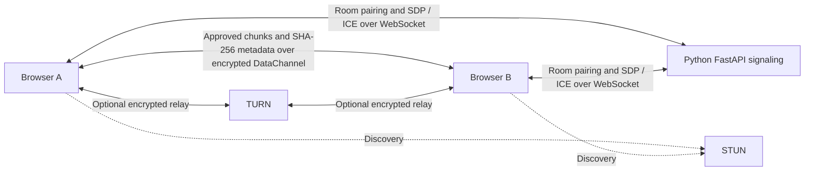
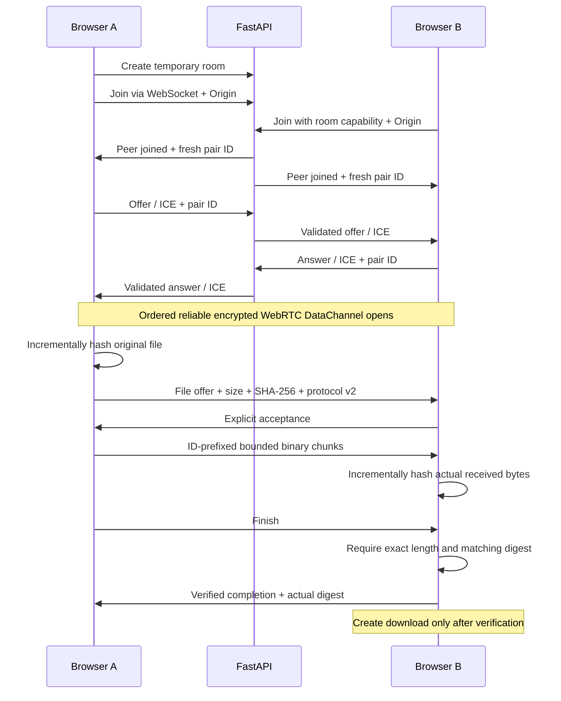

# LANFLUX 0.2

LANFLUX shares files between two browsers through an encrypted WebRTC DataChannel. A small Python FastAPI server creates temporary rooms and relays signaling; **file contents and transfer metadata never pass through that server**. No app installation or frontend build is required.

Create a room, invite your other device by code/link/QR, and approve each incoming file. Both devices can send. Version 0.2 preserves the existing sequential queues, cancellation and downloads, adds actual SHA-256 verification, tightens room/signaling security, and introduces measured network diagnostics and downloadable experiment reports.


[Mobile interface](docs/screenshots/mobile.png) · [Network diagnostics](docs/screenshots/network.png) · [Verification report](docs/VERIFICATION.md)

## Start locally

Python **3.10+**. From the repository root on Linux or macOS:

```bash
python3 -m venv .venv
source .venv/bin/activate
python -m pip install -r requirements.txt
python -m lanflux
```

Open **http://localhost:8000**. Health: **http://localhost:8000/health**. The default binds only `127.0.0.1`; it does not expose the development server to your network.

Windows PowerShell (no activation-policy changes needed):

```powershell
py -3 -m venv .venv
.\.venv\Scripts\python.exe -m pip install -r requirements.txt
.\.venv\Scripts\python.exe -m lanflux
```

For the prepared environment in this workspace, use `.venv/bin/python -m lanflux`. Use this entry point, rather than the preserved legacy root `app.py` or Pipfile.

## Share on local Wi-Fi

Explicitly enable LAN listening:

```bash
python -m lanflux --lan --port 8000
```

Without activation: `.venv/bin/python -m lanflux --lan --port 8000`. Windows: `.\.venv\Scripts\python.exe -m lanflux --lan --port 8000`.

1. Connect both devices to the same trusted Wi-Fi. Keep the browser tabs foregrounded; avoid guest-network isolation and blocking VPNs.
2. Find the computer's Wi-Fi IPv4 address with `ipconfig` (Windows), `hostname -I` (Linux), or `ipconfig getifaddr en0` (macOS; adapter names vary).
3. Open **http://YOUR-COMPUTER-IP:8000** on **both** devices, for example `http://192.168.1.42:8000`. Creating the room using this address makes its invitation/QR reachable from your phone. A phone's `localhost` means the phone itself.
4. Create a room, join on the other device, and wait for “Connected and ready”. Select a file, approve it on the receiver, wait for **Integrity Verified**, and download it. Repeat in the other direction.
5. Test decline/cancel, multiple queued files, and peer departure. Download and export records before clearing finished files.

Allow Python/port 8000 through the computer's firewall on **private networks**. If the page cannot load, check the address, firewall and client isolation. If pages load but peers cannot connect, check the connection states in Network diagnostics and try another network or configured TURN relay.

Trusted LAN HTTP remains supported where the browser exposes WebRTC: incremental hashing does not require Web Crypto or a secure context. Browser policies differ; use trusted HTTPS if WebRTC is unavailable. HTTP signaling can be intercepted or modified, so use **HTTPS/WSS for untrusted networks and internet deployment**. Local HTTP does not establish an authenticated sender identity.

## Architecture and protocol





Each direction has an independent sequential queue. Reliable ordered delivery, 16 KiB maximum payload chunks, transfer IDs and DataChannel backpressure prevent file mixing and buffer overload. Negotiated SCTP message-size limits reduce chunk sizes when needed; unusually small capabilities that would violate bounded receive-buffer overhead fail clearly. Cancellation, timeouts, malformed controls, disconnection and reload stop unfinished transfers. Restart by selecting the file again; automatic resume is not implemented. Both devices must refresh to v0.2: v1 offers without checksums are rejected.

## Integrity and security model

The sender hashes bounded **256 KiB slices** before offering the file. The receiver incrementally hashes the **actual received bytes**, checks the exact announced length, and compares SHA-256 before allocating a download Blob or acknowledging completion. Empty files are verified too. Missing/corrupted bytes or an unavailable hash engine cause failure, discard the receive buffers, and produce no successful download. Cancellation during hashing or verification cannot resurrect the transfer. Hashing is synchronous within each bounded slice and yields between sender slices, so smaller files remain preferable on low-memory phones.

The browser includes the pinned, unmodified incremental implementation from **@noble/hashes 2.4.0**, with its MIT license, recorded SHA-256 source checksums and independent known-answer tests. See [vendor provenance](lanflux/static/vendor/noble-hashes/README.md). Web Crypto's [digest API](https://developer.mozilla.org/en-US/docs/Web/API/SubtleCrypto/digest) requires a secure context and a complete input buffer; LANFLUX does not use it for file hashing or make an extra complete file copy for hashing.

SHA-256 metadata is bound to the established encrypted WebRTC channel, **not to a verified real-world person**. A matching digest proves transferred-byte integrity relative to the sending peer's metadata. A malicious peer can supply its own file and matching hash. Confirm the other device and share room links privately; room codes are bearer capabilities, not accounts. HTTP signaling or a compromised signaling service can undermine peer authentication. HTTPS protects the signaling path, but this MVP does not implement a separate out-of-band fingerprint check.

Server protections include:

- Cryptographic 16-character room identifiers, exactly two peers, one-hour default absolute expiration, empty-room cleanup, and configurable idle-peer cleanup (default 60 seconds; clients heartbeat every five seconds).
- Strict canonical same-origin WebSocket checks, including scheme/host/port and IPv6; additional origins must be explicitly configured. Missing/null/malformed/duplicate Origin headers are rejected.
- Host validation permits localhost, legitimate private/loopback addresses, unqualified LAN names and `.local`; public/custom DNS names require exact configured trust. Arbitrary public Host names are rejected. Default ports are normalized; trusted hosts and allowed origins are separate controls.
- Per-client room creation **10/minute**, join attempts **30/minute**, QR requests **60/minute**, and per-peer signaling **180/minute**. Bounded room/peer/rate-limit state; signaling size and strict schema validation; duplicate JSON fields, binary signaling and unexpected negotiation transitions rejected.
- Server-owned peer roles and fresh pair IDs on replacement; stale SDP/ICE cannot authorize a new pairing. The room socket binds peer identity to membership. Peer names are labels, not authentication.
- A self-hosted frontend, restrictive content/security headers, safe filename normalization and text-only rendering. No upload, arbitrary filesystem or remote-command routes.
- The recommended CLI disables access logging and filters sensitive room paths/query strings and WebSocket debug frame dumps. No full SDP/ICE payloads or file data are intentionally logged. External proxies must also redact room paths/query strings.

An authorized peer can still cause denial of service or send unwanted content. Do not treat receipt as proof that a file is safe to execute. Public deployments require edge-level abuse controls; the in-process limits are intended for this small application.

## Real network diagnostics and experiments

Network diagnostics displays WebSocket/ICE/DataChannel states, selected route, payload throughput, active transfer duration, remaining-time estimate, connection setup time and **explicit DataChannel ping/pong RTT**. One-second samples feed a bounded **60-point** chart. Metrics unsupported by the browser or not yet observed display **Unavailable**. Private ICE addresses appear only after **Inspect connection details**, stay on that screen, and are excluded from reports. Hide them before sharing screenshots.

Route detection uses a successful, unambiguous selected candidate pair from [RTCPeerConnection.getStats()](https://developer.mozilla.org/en-US/docs/Web/API/RTCPeerConnection/getStats). **Direct** requires known non-relay candidates; **TURN relay** means encrypted file traffic passes through a relay. Unknown statistics are not proof of directness. STUN discovers connectivity and does not relay file contents.

Units and timing:

- Sizes use **MiB = 1,048,576 bytes**. Rates use decimal **MB/s = bytes/s ÷ 1,000,000**, and **Mbps = bytes/s × 8 ÷ 1,000,000**.
- Sender payload bytes count data handed to the DataChannel; receiver bytes count accepted file payload. These observations exclude frame headers and are not proof of delivered bytes until verified completion.
- Per-file duration runs from acceptance/start until verified completion (including the acknowledgement on the sender). SHA-256 prehash and time waiting for human approval are excluded. Average throughput uses observed bytes/duration; failure records can include partial data.
- Setup runs from peer pairing until DataChannel open; later transfers on the same connection retain that setup observation. It excludes time waiting for someone to join the room.
- Current/peak speed uses complete sample intervals. A short transfer may have **Unavailable** peak speed. Dashboard average/duration aggregate the union of active send/receive intervals, excluding idle gaps; duplex rates sum observed bytes in both directions.
- RTT includes browser scheduling and DataChannel queueing; it is an application round trip, not an ICMP ping or a pure propagation delay. ETA is approximate and unavailable without a positive observed rate.

Export real terminal transfer records as a human-readable report or CSV. Exports contain file size, payload bytes, setup/duration, average/peak Mbps, result/reason, digests, verification and observed route. Conditions/notes are explicitly user-entered. CSV escapes spreadsheet formulas. Exports remain local; no telemetry is uploaded.

Generate fixtures with Python (files are below the configured limits):

```bash
python scripts/generate_test_files.py
```

This creates **1, 10 and 50 MiB** random binary files plus their independent Python SHA-256 digests in ignored `experiment-files/`. It does not measure networking or overwrite existing fixtures. Follow the [reproducible experiment methodology](docs/NETWORK_EXPERIMENTS.md): three actual runs per size, export collected records, and compare Wi-Fi conditions or a real TURN relay without inventing results.

## Limits and compatibility

Default limits remain **64 MiB/file**, **128 MiB reserved/retained receive payload**, **20 active/queued files**, and **100 retained transfer records**. Completed downloads count toward memory until cleared. Blob/download internals and buffer overhead can consume additional memory beyond payload limits; there is no streaming-to-disk support. Lower limits using `.env` on low-memory phones. Download/export before clearing or closing the tab. Leaving a room preserves completed downloads in the current tab; reload/navigation removes them.

Targets current Chrome/Edge/Firefox/Safari and Android Chrome/iOS Safari with WebRTC DataChannels. Chromium automated checks and mobile viewport emulation do not establish Safari/Firefox or physical-phone compatibility. The user reported successful computer↔phone testing of v0.1; **v0.2 still needs that physical-device regression**. Backgrounding, sleep or locking a mobile browser can suspend transfers and trigger cleanup. Downloads on iOS may use a preview/share sheet.

No folders, accounts, resumable transfers, persistent history or more than two peers. Restarting Python loses rooms. Use **one worker**: rooms/signaling are process-local. No TURN service is bundled; restrictive NATs/firewalls or isolated Wi-Fi can prevent connectivity without a suitable relay.

## Configuration and deployment

Copy `.env.example` to `.env`; `python -m lanflux` loads it automatically. Alternatively use `--env-file PATH`. Run `python -m lanflux --help` for bind/port/TLS options. The example contains no real secrets.

| Environment variable | Purpose |
| --- | --- |
| `LANFLUX_PUBLIC_URL` | Browser-visible origin for invitation/QR links, e.g. `https://share.example.com` |
| `LANFLUX_ALLOWED_ORIGINS` | Additional exact HTTP(S) browser origins, comma-separated, no paths/wildcards |
| `LANFLUX_TRUSTED_HOSTS` | Extra exact public/custom DNS hostnames, no ports/wildcards; PUBLIC_URL/allowed-origin hosts are also trusted |
| `LANFLUX_ROOM_TTL_SECONDS` | Absolute room life; default 3600, range 60–86400 |
| `LANFLUX_PEER_IDLE_TIMEOUT_SECONDS` | Idle signaling cleanup; default 60, range 15–300 |
| `LANFLUX_MAX_ROOMS`, `LANFLUX_MAX_PEERS` | In-process resource caps; defaults 1000 and 512 |
| `LANFLUX_MAX_FILE_MIB`, `LANFLUX_MAX_MEMORY_MIB` | Lower browser payload limits; maximums 64 and 128 |
| `LANFLUX_STUN_URLS` | Comma-separated `stun:` URLs; empty disables STUN for isolated LAN tests |
| `LANFLUX_TURN_URLS` | Comma-separated `turn:`/`turns:` URLs; requires username/credential |
| `LANFLUX_TURN_USERNAME`, `LANFLUX_TURN_CREDENTIAL` | Browser-visible relay credentials; no real values in source |
| `LANFLUX_ICE_TRANSPORT_POLICY` | `all` or `relay`; forcing relay requires reachable TURN configuration |

Example optional TURN configuration (substitute your own service; these are placeholders, not operational credentials):

```dotenv
LANFLUX_TURN_URLS=turn:turn.example.com:3478?transport=udp,turns:turn.example.com:5349?transport=tcp
LANFLUX_TURN_USERNAME=short-lived-user
LANFLUX_TURN_CREDENTIAL=short-lived-credential
```

Public deployment requires **HTTPS/WSS**, a TLS reverse proxy forwarding WebSocket Upgrade and preserving the browser-visible Host, a private Uvicorn upstream, one worker, and exact public origin configuration. Avoid caching `/api/config`. Trust forwarded headers only from your own proxy; do not configure a blanket forwarded-IP trust on an exposed upstream. Keep proxy access logs from recording invitation queries or room socket paths.

TURN credentials are delivered to browsers. A public deployment needs restricted, expiring credentials and relay quotas; this version reads static credentials from the environment and does **not** issue or rotate them. Remote connectivity can fail without a correctly configured relay. Settings “Relay only” applies to the next room/connection. Verify the observed relay route before labeling an experiment as TURN.

For local HTTPS, use certificates trusted by **both devices**; accepting an untrusted warning is not a portable setup. Optional CLI: `python -m lanflux --lan --ssl-certfile PATH --ssl-keyfile PATH`. Never publish the development server as a public service by default.

## Tests and project structure

```bash
python -m pip install -r requirements-dev.txt
python -m pytest -q
npm ci
npx playwright install chromium
npm run test:unit
npm run test:e2e
```

Node **20.19+** and Playwright are development-only. Python serves the vendored frontend directly; no npm dependency or CDN is required at runtime. `npm run vendor:hashes` reproducibly refreshes the pinned hash sources and manifest after `npm ci`.

Current checks: **72 Python tests**, **36 JavaScript unit tests**, and **12 real Chromium browser scenarios plus their parent test** passed. See [exact verification and remaining untested conditions](docs/VERIFICATION.md). Browser tests start a localhost fixture on port 8765, use separate real browser contexts, and compare actual downloaded bytes. They also verify local insecure-HTTP hashing, corruption failure, interruptions, narrow layouts, diagnostics and exports. No physical-device, TURN or public-deployment result is claimed.

- `lanflux/`: FastAPI entry point, validated configuration, room/signaling state, safe logging and CLI.
- `lanflux/static/`: native HTML/CSS/JS, transfer engine, metrics, diagnostics, experiment exports and licensed hash implementation.
- `tests/`: Python signaling/security and JavaScript/hash/metrics/export/browser regressions.
- `scripts/`: bounded fixture generator and hash-vendoring tool.
- `docs/`: inspection, verification, experiment methodology and real interface screenshots.

## Attribution and licensing

This workspace began with [alwaz-shahid's P2P-File-Sharing-on-Local-Network](https://github.com/alwaz-shahid/P2P-File-Sharing-on-Local-Network). Inspection found server-side HTTP upload/download behavior despite its P2P description. LANFLUX's Python signaling and browser transfer implementation were independently written under `lanflux/`; the original `app.py`, templates and Pipenv files remain preserved locally and are not executed.

**The upstream did not advertise a license. Attribution does not grant redistribution rights.** Original source and the local `legacy/` archive remain ignored for new commits and are excluded from this LANFLUX publication. No new license is applied to those originals. Obtain permission before redistributing original source. See [repository inspection](docs/REPOSITORY_INSPECTION.md).

The vendored @noble/hashes sources have their own [MIT copyright/license](lanflux/static/vendor/noble-hashes/LICENSE), which is retained with provenance. That license does not cover upstream project code or assign a license to the whole LANFLUX repository.
