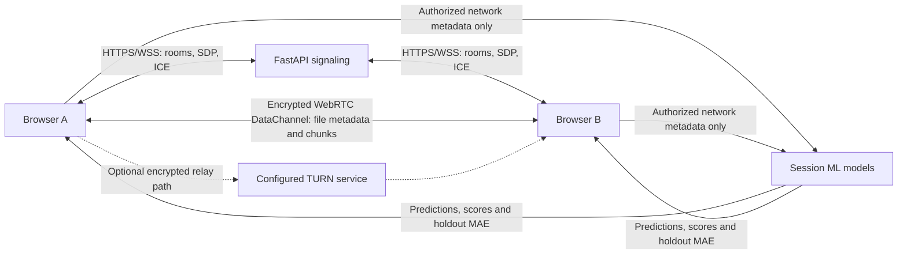
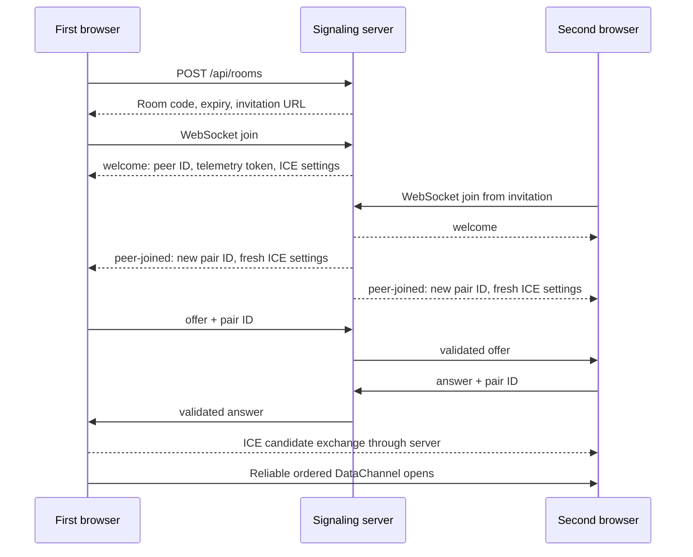
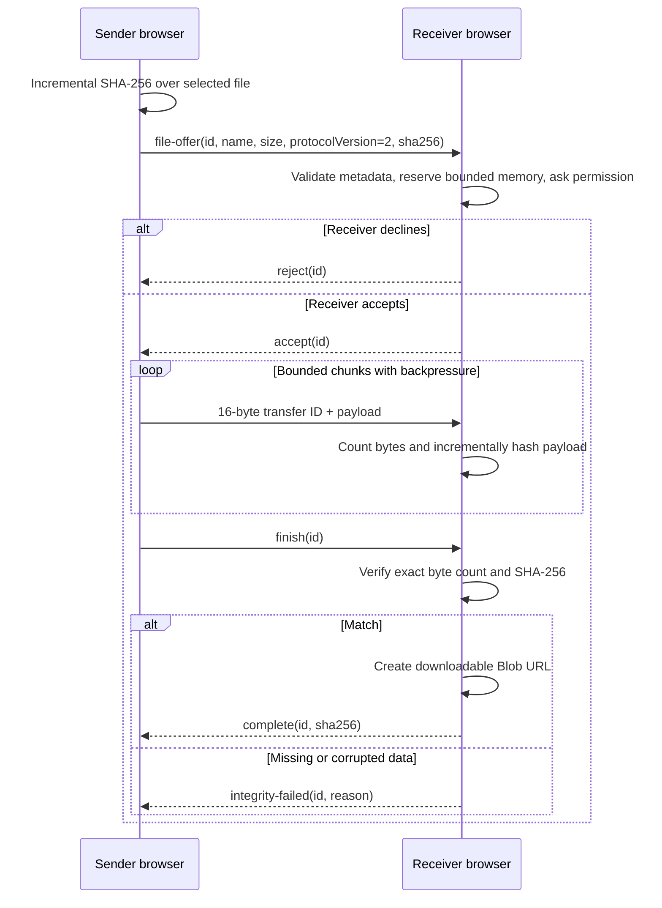

# Architecture and protocol

LANFLUX has three distinct paths: a Python signaling service introduces two browsers, a WebRTC DataChannel carries file data between those browsers, and an authenticated metadata API evaluates optional network models. The application has no upload endpoint and no server-side file store.

For setup and operation, see the [user guide](USER_GUIDE.md). Configuration and public deployment are covered in [configuration](CONFIGURATION.md) and [deployment](DEPLOYMENT.md). The [security model](SECURITY.md) describes what these boundaries do and do not guarantee.

## Components and ownership

| Component | Responsibility |
| --- | --- |
| `lanflux/main.py` | FastAPI application, security headers, room/QR routes, WebSocket admission, strict message parsing and static assets. |
| `lanflux/rooms.py` | Process-local room membership, cryptographic identifiers, pair generations, negotiation states, expiration, bounded rate-limit buckets. |
| `lanflux/signals.py` | Strict Pydantic schemas for offer, answer, ICE and heartbeat messages. |
| `lanflux/config.py`, `turn.py` | Validated environment settings and ICE configuration; optional short-lived coturn credentials. |
| `lanflux/network.py` | Physical-LAN address discovery and invitation-origin selection. |
| `lanflux/logging.py`, `__main__.py` | Sensitive-log filtering and the supported single-worker CLI. |
| `lanflux/static/app.js` | Existing interface, room actions, transfer cards, dialogs and navigation. |
| `transfer.js` | WebSocket/RTCPeerConnection lifecycle, transfer state machine, framing, approval, hashing and bounded buffering. |
| `metrics.js`, `diagnostics.js`, `ice.js` | Observed payload statistics, selected-candidate classification, diagnostics presentation and safe ICE configuration. |
| `invitation.js`, `experiments.js` | Invitation normalization and report/CSV formatting from recorded transfers. |
| `aiml.js` | Session-authorized telemetry collection and the AI monitor/forecast interface. |
| `aiml/api.py`, `model.py`, `predictor.py` | Metadata authorization, bounded IsolationForest baseline and supervised throughput forecasting. |
| `aiml/evaluate.py` | Offline chronological evaluation of exported anomaly-monitor observations. |

All room and model state is memory-only. Run **one Uvicorn worker**. Multiple independent workers cannot share rooms or peer models, and a restart clears active sessions. Horizontal scaling would require an explicitly designed shared signaling/session layer; it is not implemented.

## Data paths

TURN is a separate network relay, not a FastAPI upload fallback. File transport remains WebRTC-encrypted when a relay carries its packets. A TURN server can observe network metadata and traffic volume; it does not become the file's application receiver. A configured relay is not proof it was selected.

## HTTP and WebSocket surface

| Route | Purpose and boundary |
| --- | --- |
| `GET /`, `/static/...` | Browser application and bundled assets. |
| `GET /health` | Basic service liveness; does not prove peer connectivity. |
| `GET /api/config` | Public limits, STUN settings, invitation origin and TURN capability flags; no TURN passwords. |
| `POST /api/rooms` | Create a bounded, expiring two-peer room. |
| `GET /api/rooms/{id}/qr[.svg]` | SVG QR for that room's pinned invitation URL. |
| `WS /ws/{id}?name=...` | Same-origin admission, pairing, offer/answer/ICE and heartbeat. |
| `POST /api/aiml/sample` | Authorized measurement submission and model result. |
| `POST /api/aiml/reset` | Clear this peer's model and observations. |
| `POST /api/aiml/export` | Download this peer's retained metadata CSV. |

The ML POST routes require a peer-bound Bearer token, strict JSON, trusted Origin, a non-expired room and two live members. There is no file-upload, remote-command or arbitrary filesystem endpoint.

## Room creation and invitation

A room receives a 16-character identifier generated using `secrets.choice`. Its default absolute lifetime is one hour. The identifier is a bearer capability: possession enables admission while capacity remains available; it is not an account or proof of identity.

An explicit `LANFLUX_PUBLIC_URL` selects the invitation origin. Otherwise, an existing LAN/public page origin is retained, while a localhost invitation can use a discovered active physical private IPv4 adapter. Discovery excludes recognized Docker, virtual and VPN interfaces and prefers the default route. It is best-effort on multihomed machines: configure a reachable origin when discovery is ambiguous.

The room pins one invitation URL at creation so the QR, displayed address and Copy Link agree. Discovery refreshes for new rooms; an old room does not silently change its invitation after an adapter change. Opening a valid `?room=CODE` starts joining automatically. Invalid, expired or full rooms produce an actionable error rather than creating an unrelated room.

## Pairing and signaling sequence

The first member is the negotiation initiator. The server permits `ready → offered → answered`, with the offer restricted to the initiator and the answer to the other member. ICE may arrive while candidates are gathering, including before the offer reaches the server. Every paired signal carries a fresh pair ID. A departed/replaced peer's stale messages cannot negotiate a new pairing.

Clients heartbeat approximately every five seconds; default signaling inactivity closes a peer after 60 seconds. Cleanup runs every five seconds. A room that becomes empty is shortened to at most a 60-second grace period. Absolute room expiry closes its members. Departure clears the pair generation and both peers' ML state; the remaining member can pair again while the room remains valid.

The browser starts a 45-second connection deadline. It also bounds queued ICE candidates and serializes signaling processing to avoid asynchronous reordering. A failed or closed connection stops incomplete transfers and provides clean restart behavior. Automatic resumable transfer is not implemented.

## File-transfer protocol, version 2

The initiator opens `lanflux-files` as an ordered DataChannel with default reliable delivery. Each browser can send and receive concurrently, while each outgoing direction uses a sequential queue. Up to one incoming file is accepted into the receive state at a time. The queue is not a multi-recipient broadcast mechanism.

### Approval and integrity sequence

The sender hashes in 256 KiB file slices, yielding between slices. It does not load an additional complete file solely to hash it. The receiver updates a hash as approved payload arrives. The bundled incremental implementation works on local HTTP without depending on streaming Web Crypto. Zero-byte files follow the same offer/approval/finish/digest path.

Metadata and digests travel inside the encrypted DataChannel. They are authenticated to the established WebRTC transport peer, not independently signed by a known human identity. A digest match means the receiver obtained the bytes matching the offered digest. It does not attest to the file's safety or origin.

### States and terminal rules

| Direction | Normal states | Other terminal outcomes |
| --- | --- | --- |
| Sender | `queued → hashing → awaiting-approval → transferring → completed` | `rejected`, `cancelled`, `failed` |
| Receiver | `approval-needed → transferring → verifying → completed` | `rejected`, `cancelled`, `failed` |

A sender completes only after a valid matching receiver acknowledgement, following its finish message. A receiver completes only after exact-size and digest checks. Terminal transitions are guarded so late cancellation, duplicate acknowledgements and delayed frames do not convert a cancelled/failed transfer into success. Downloads require completed, verified receive state and a valid Blob URL.

Unknown control types/fields, invalid IDs, unapproved payload and impossible transitions are rejected. Control frames are bounded to 8,192 string characters. Binary frames contain a 16-byte transfer identifier and at most 16 KiB of payload. The sender reduces payload size when a finite negotiated SCTP message limit requires it; impossibly small limits fail cleanly. A chunk-count bound rejects excessive tiny-buffer overhead.

### Backpressure and timeouts

`bufferedAmountLowThreshold` is 64 KiB. When the channel's buffered amount exceeds 256 KiB, sending waits for a low-buffer event, closure, cancellation or a 30-second stall timeout. The implementation rechecks after registering listeners to avoid a missed drain event. The high-water mark is a sending threshold, not a promise that all browser memory is limited to that exact value.

Approval has a 120-second inactivity timeout; active preparation/transfer/verification has a 90-second inactivity timeout, checked by the five-second maintenance tick. These are inactivity thresholds, not maximum total durations. Both sides can cancel. Disconnects close the channel/peer connection, fail incomplete work, discard incomplete chunks and stop related listeners/waiters. Leaving clears periodic timers and room credentials.

## Memory and lifecycle

Default limits are 64 MiB per file, 128 MiB of reserved/retained receive payload, 20 nonterminal/queued entries and 100 retained transfer records. Lower file and payload budgets are configurable. A receive reserves its announced size before acceptance; rejected/cancelled/failed transfers release it. Completed receives continue to consume the budget until cleared. Clearing terminal records revokes Blob URLs and releases their reservations.

These limits bound application payload accounting, not total browser resident memory. ArrayBuffer/Blob copies, hash state, DOM and browser networking add overhead. Mobile users should clear completed downloads and keep foreground tabs awake. No streaming-to-disk, folder traversal, persistent transfer archive or automatic resume is advertised.

## Observability and units

`PayloadMetrics` uses monotonic browser time and actual application payload-byte counters. Current speed is a sample delta divided by elapsed time; average is bytes divided by active transfer duration; ETA uses remaining bytes and current positive speed. With concurrent bidirectional transfers, aggregate active duration is union time, not the sum of overlapping send and receive durations. Speed history retains at most 60 samples.

File sizes use binary MiB (`1 MiB = 1,048,576 bytes`). Transfer UI rates may be formatted in decimal MB/s; AI throughput uses decimal Mbps (`bytes × 8 / seconds / 1,000,000`). These are payload rates, excluding protocol overhead. Sender counters measure payload handed to the DataChannel; receiver counters measure accepted payload. A successful verified transfer is the end-to-end correctness check.

RTT is explicit DataChannel ping/pong elapsed time, approximately every five seconds, not ICMP or pure network propagation latency. Channel queues and scheduling contribute. Reliable selected-pair ICE statistics classify direct versus relay only when both candidate types are available and unambiguous. Unsupported metrics show Unavailable. Private ICE addresses require the explicit inspection action and never enter ML metadata.

## Session-local intelligence

The anomaly model and forecaster consume the same authorized observations but solve different problems:

| Model | Input and training | Output |
| --- | --- | --- |
| IsolationForest | `log1p(RTT)`, `log1p(Mbps)`, active flag; at least 30 real rows, 25 server-monotonic seconds and three distinct feature combinations. Up to 120 baseline rows, 64 trees, one worker. Baseline freezes after training. | Normal/Anomaly and negative decision-function score for later observations. |
| RandomForestRegressor | Five past active samples: speed level/mean/variation/trend, RTT/variation, active fraction and observed route flags. Labels are subsequent measured three-second weighted throughput. At least 60 labeled windows and meaningful speed variation; bounded 48-tree forest. | Experimental next-three-second aggregate active-throughput forecast and chronological holdout MAE versus last-speed baseline. |

The forecaster accepts 750–2000 ms intervals with consistent server receipt gaps. Missing/irregular samples break pending windows. It excludes idle input/label windows; real active stalls can have zero speed. The earliest 70% of examples are training candidates and the latest 30% validation; training labels overlapping validation inputs are purged. At least 30 training and 12 validation examples must remain. At most 240 labeled examples are retained; a successful refit needs 30 new labels and 60 seconds since the previous fit.

Recommendations are transparent advisory rules, not a third trained model. They combine anomaly status, forecast trend and validation comparison. Forecasts clear when stale, idle or unavailable. Baseline sends as before. Optional `adaptive.js` policy can add bounded sender waits; it never changes wire fields, chunks, consent, verification or native congestion control. Fresh model evidence and explicit user selection gate ML assistance. Three-second anchored bursts and five-second unpaced recovery avoid recursive slowdown; missing evidence restores original sending. `comparison.js` tracks local requested/effective strategies, actual wait and verified terminal outcomes, with distinct-ping RTT sampling and bounded privacy-safe exports.

Telemetry adds a categorical sending strategy. Only unpaced baseline intervals train either model; receive-byte counters and policy-generation changes exclude mixed intervals. Remote policy is unknown for receiving/bidirectional observations. Policy changes clear pending feature/label windows; inference on intervention-conditioned windows is labeled accordingly.

Model operations run through `asyncio.to_thread`, with two concurrent operations and per-peer locks. There are at most 32 monitor instances and 600 retained CSV records per monitor. Models and records disappear on reset, pair change, departure, expiry or server restart. Measurements are authorized browser reports, not independent instrumentation or fabricated training data. See [AI algorithms, evaluation and demonstration](AI_MONITOR.md) for exact interpretation and limitations.
