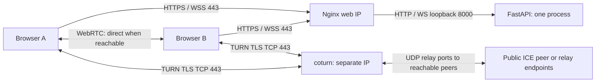

# Public HTTPS and TURN deployment

This guide describes infrastructure you must operate; the repository does not provision a VPS, DNS, certificates or a TURN service. It is suitable for an authorized small deployment, including testing from Wi-Fi with client isolation. It does not guarantee passage through restricted networks or override college policy. Obtain permission from the network administrator when required.

## Topology and prerequisites

Use a supported Linux server with Python 3.10+, Nginx, systemd and a current security-patched coturn package. You need two public IP endpoints, DNS you control, valid publicly trusted certificates, provider firewall access and sufficient relay bandwidth. These examples use:

| Endpoint | Public listener | Service |
| --- | --- | --- |
| `share.example.com` → web server IP | TCP 443 | Nginx HTTPS and same-origin WSS |
| Web server loopback | `127.0.0.1:8000` only | One LANFLUX Python process |
| `turn.example.com` → separate TURN server IP | TCP 443 | coturn TURN over TLS |
| TURN server IP | UDP 49160–49259 | TURN relay allocations |

The two hostnames must resolve to **different public IPs** when both listeners bind TCP 443. Two DNS records on one IP do not avoid a port conflict. Two VPSs are the simplest arrangement; one server with two explicitly bound public IPs also works after adapting the Nginx listener. Nginx's HTTP `proxy_pass` cannot forward raw TURN traffic. This guide does not implement a shared-port TCP multiplexer.

Use DNS-only records for TURN; a normal HTTP CDN proxy does not carry TURN. Publish AAAA records only after configuring and testing IPv6 routing, listeners, certificates and relay firewall rules. The supplied coturn example binds an IPv4 address. A cloud public IP implemented by 1:1 NAT needs correct `external-ip=PUBLIC_IP/PRIVATE_IP`, binding to the local private address, with port-preserving forwarding of the complete relay range. A directly assigned public IP is easier to diagnose. [Coturn server options](https://github.com/coturn/coturn/wiki/turnserver).



File bytes use WebRTC's encrypted transport. A selected TURN route relays encrypted file traffic through coturn; it is not a direct network path between browsers. FastAPI handles signaling and does not upload or store files.

## Firewall requirements

Configure both the provider security group and the operating-system firewall. Permit return traffic for established connections. Restrict administrative SSH to administrator addresses.

| Location | Required rule for these examples |
| --- | --- |
| Client network outbound | TCP 443 to the web domain and separately TCP 443 to the TURN domain. Optional STUN servers need their advertised UDP ports. |
| Web server inbound | TCP 443; TCP 80 only if using the supplied redirect or HTTP certificate validation. Never expose TCP 8000. |
| TURN server inbound | TCP 443 and UDP 49160–49259. These examples disable plaintext TCP/UDP client listeners and DTLS. |
| TURN server outbound | UDP to permitted public peer/relay IPs and ports, plus replies on client TCP/TLS connections. Restrict private/special destinations as described below. |

TCP/TLS is the **browser-to-TURN** transport. Coturn still allocates UDP relay sockets and exchanges traffic with ICE peer endpoints; blocking the relay range breaks this setup. `no-tcp-relay` disables RFC 6062 TCP allocations, not the browser's TCP/TLS connection. Optional `turn:HOST:3478?transport=udp` requires enabling the UDP client listener and opening UDP 3478 in addition to the relay range. [Coturn transport and port options](https://github.com/coturn/coturn/wiki/turnserver).

Port 443 alone does not imply permission: a firewall may allow HTTPS while rejecting TURN TLS, unapproved domains or WebRTC. HTTP-only forward proxies, TLS inspection, packet loss, browser restrictions and captive portals can still prevent pairing. Use an IT-approved service/network when necessary; do not disable certificate verification or attempt to bypass policy.

## Install the private Python service

Install the application under `/opt/lanflux` using an unprivileged `lanflux` service account. Keep the application and its virtual environment owned by the deploying administrator, readable/executable by the service user, and not writable by web clients. Create the environment and install dependencies using the project's setup instructions:

```bash
cd /opt/lanflux
python3 -m venv .venv
.venv/bin/python -m pip install -r requirements.txt
```

Copy [the public environment template](../deploy/systemd/lanflux.env.example) to `/etc/lanflux/lanflux.env`. Replace all example domains and the secret. The same secret must appear in the private coturn configuration; it must not appear in browser code, public config responses, command-line arguments, logs or Git. Generate one privately, for example with `openssl rand -hex 32`, and place it directly into the protected configuration files. Suggested ownership: `/etc/lanflux` root:lanflux mode 0750, environment file root:lanflux mode 0640.

Install [lanflux.service.example](../deploy/systemd/lanflux.service.example) as `/etc/systemd/system/lanflux.service`. Check its paths and account, then:

```bash
sudo systemctl daemon-reload
sudo systemctl enable --now lanflux
curl --fail http://127.0.0.1:8000/health
```

Keep one worker and one instance: rooms and AI state are in memory. A restart drops rooms and active signaling. Do not add load balancing or multiple workers without implementing shared room/signaling state. The unit uses the supported CLI, safe application logging and exact loopback proxy trust; no arbitrary forwarded-header trust is needed. [Uvicorn proxy-header settings](https://uvicorn.dev/settings/#http).

## Configure HTTPS and WebSockets

Obtain a publicly trusted certificate for `share.example.com`, with automatic renewal. Certificate provisioning depends on your DNS/ACME provider; it is not automated here. Install [the Nginx template](../deploy/nginx/lanflux.conf.example) in Nginx's `http` configuration context, replacing hostnames and certificate paths. Its `map` and rate-limit zones must be outside a `server` block. Keep default sites from unintentionally exposing the upstream or matching other hostnames.

The template requires HTTP Basic authentication over HTTPS. Create `/etc/nginx/lanflux.htpasswd` with the platform's `htpasswd` tool and separate strong credentials for approved users, or replace this with your organization's authenticated edge. Keep the password file root-owned and readable by the Nginx worker group, mode 0640. Never put passwords in invitation URLs. Test authentication and WebSocket upgrade in the actual target browsers before rollout; an SSO edge must preserve authenticated WSS access too. LANFLUX itself has no user accounts. Room codes and Origin validation do not substitute for this access control.

The exact AI routes `/api/aiml/sample`, `/api/aiml/reset` and `/api/aiml/export` use the application's live-peer Bearer token and Origin checks instead of Basic authentication, because one Authorization header cannot carry both schemes. They remain protected by backend authorization. The proxy forwards only Bearer credentials to Python and strips Basic passwords. Every other path, including all room APIs and WebSocket admission that issues TURN credentials, keeps edge authentication. Do not widen the exception to `/api/` or `/ws/`. [Nginx variable authentication realms](https://nginx.org/en/docs/http/ngx_http_auth_basic_module.html).

The proxy preserves Host and forwards Upgrade/Connection explicitly for WSS. It **replaces** client-supplied forwarded IP/protocol values with the actual connection values. Python accepts those values only from the exact local proxy IP. If there is another upstream proxy/CDN, configure its trusted real-IP chain deliberately; do not copy this example and trust every sender. [Nginx WebSocket proxying](https://nginx.org/en/docs/http/websocket.html).

```bash
sudo nginx -t
sudo systemctl reload nginx
curl --fail --user YOUR_APPROVED_USERNAME https://share.example.com/health
```

The last command prompts for the password. Do not use `curl -k` or browser certificate-warning exceptions. Public room URLs, QR codes, API requests and WSS must all use the exact configured HTTPS origin, with no subpath prefix. The proxy disables response caching and access logs for this service. Error logs can still contain sensitive request context; restrict access, retention and collection, and avoid verbose debug logging.

## Configure coturn with expiring credentials

Use [turnserver.conf.example](../deploy/coturn/turnserver.conf.example), replacing the documentation IP, domain, certificate paths and shared secret. It targets coturn 4.6.x configuration syntax; use a currently patched distribution package and review its installed `turnserver -h`/manual. Newer releases may remove `no-tlsv1`, `no-tlsv1_1` or `no-cli` while disabling obsolete TLS versions/management listeners by default. Remove an obsolete directive only after checking the replacement behavior; verify that TLS 1.0/1.1 remain disabled. Do not enable the `tlsv1`/`tlsv1_1` compatibility flags on newer versions. [Upstream coturn configuration reference](https://github.com/coturn/coturn/blob/4.6.3/examples/etc/turnserver.conf).

Coturn uses `use-auth-secret` and `static-auth-secret`; the word “static” refers to the **server-held signing secret**, not a permanent public client password. LANFLUX issues timestamped usernames with Base64 HMAC-SHA1 credentials to admitted room peers in WebSocket messages. Public `/api/config` has availability flags and STUN configuration, without TURN credentials. The default credential lifetime is 600 seconds, configurable from 60–3600; keep web/TURN clocks synchronized. A replacement pairing receives fresh credentials. The expiration bounds use for new allocations; it is not a precise forced termination time for an already authenticated allocation. [Coturn REST credential design](https://github.com/coturn/coturn/blob/master/README.turnserver#turn-rest-api).

Keep both static username/credential environment variables empty in shared-secret mode. Static credentials remain an option for controlled private deployments, but do not publish a reusable relay password. Do not use coturn `no-auth`, `server-relay`, `allow-loopback-peers`, plaintext downgrade URLs as a workaround, or wildcard peer exceptions. Room admission remains anonymous without the protected edge; expiry does not prevent abuse by someone who can repeatedly obtain admitted rooms. Apply edge access control, issuance/request limits, allocation quotas, bandwidth caps and provider spending alerts together.

The example denies loopback, private, link-local, carrier-grade NAT, multicast and other special peer targets, including cloud metadata address space. Add provider-specific internal/service ranges and enforce outbound firewall policy as a second layer. Do not override denied ranges with `allowed-peer-ip`: coturn gives explicit allows precedence. Private destination denial is intentional; this public relay is not an internal network access service. [Coturn peer ACL and quota options](https://github.com/coturn/coturn/wiki/turnserver).

Install a trusted full certificate chain for `turn.example.com`. Use a dedicated `/etc/lanflux-turn/tls` directory root:turnserver mode 0750 and a private key root:turnserver mode 0640; use the account name your distribution actually provides. Never make keys world-readable. Certificate renewal must securely update the readable copies and restart coturn according to the installed version's behavior. Ensure the certificate covers the TURN URL hostname. TLS 1.2 or newer is required.

Use [the coturn systemd example](../deploy/systemd/lanflux-turn.service.example) if you are not using the distribution's maintained unit. Do not run both units on the same ports. This example runs as `turnserver` and grants only the low-port bind capability required for 443. Systemd creates private runtime/state directories for the PID file and coturn database. Protect the coturn configuration root:turnserver mode 0640. Logs go to the protected system journal; retain only what operations require. The sample quotas are small starting limits, not capacity guarantees: tune after measuring, and keep the relay port pool consistent with allocation limits.

## Verify the deployed service

1. Confirm DNS resolves from both networks, both certificates validate, and `https://share.example.com/health` succeeds after edge authentication. Check that external connections to port 8000 fail.
2. Check TURN TLS independently: `openssl s_client -connect turn.example.com:443 -servername turn.example.com -verify_hostname turn.example.com -verify_return_error </dev/null`. This checks the TLS endpoint only; it does not prove TURN allocation, relay ports or file transfer.
3. On two authorized devices, open the HTTPS site, create/join a fresh room and transfer a small known file with receiver approval. Download it and compare its SHA-256 against the source. Inspect the observed route; `Unknown` is not proof of either direct or relay operation.
4. To test TURN, set Settings → Relay only before the next connection on both browsers, leave/rejoin a fresh room and repeat the verified download. Require an observed **TURN relay** route. Restore the normal policy afterward. Test once across genuinely separate networks and once on the intended college Wi-Fi with permission.
5. Verify wrong/expired credentials cannot create allocations, private peer destinations are denied, quotas limit allocations, WSS survives idle heartbeats, certificate renewal works and a service restart cleans up rooms. Inspect logs without collecting room capabilities, credentials, file names or file bytes.

Do not claim a successful physical-phone, public-network or college-network test from local browser automation. The examples require deployment-specific validation; a local TLS coturn fixture is not evidence that your provider firewall, DNS, certificates or college policy permit the production route.

## Troubleshooting

| Symptom | Check |
| --- | --- |
| Website works; room WebSocket fails | Authenticated WSS, proxy Upgrade headers, exact Origin/Host, forwarded HTTPS scheme and trusted local proxy IP. |
| Both peers appear; ICE fails | TURN URL/hostname/certificate, clock skew, matching REST secret, actual credentials issued after room admission, client egress and server relay UDP rules. |
| TLS test works; relay transfer fails | TLS alone does not test allocations. Check quotas, denied peer ranges, UDP relay range, public/private address mapping and external firewall logs. |
| Works at home; fails on campus | Captive portal, client isolation, domain allowlist or TURN protocol filtering. Request an authorized network configuration from IT. |
| Intermittent failure after replacement/restart | Create a fresh pairing to obtain current credentials; confirm only one Python worker. Server restarts intentionally discard rooms. |
