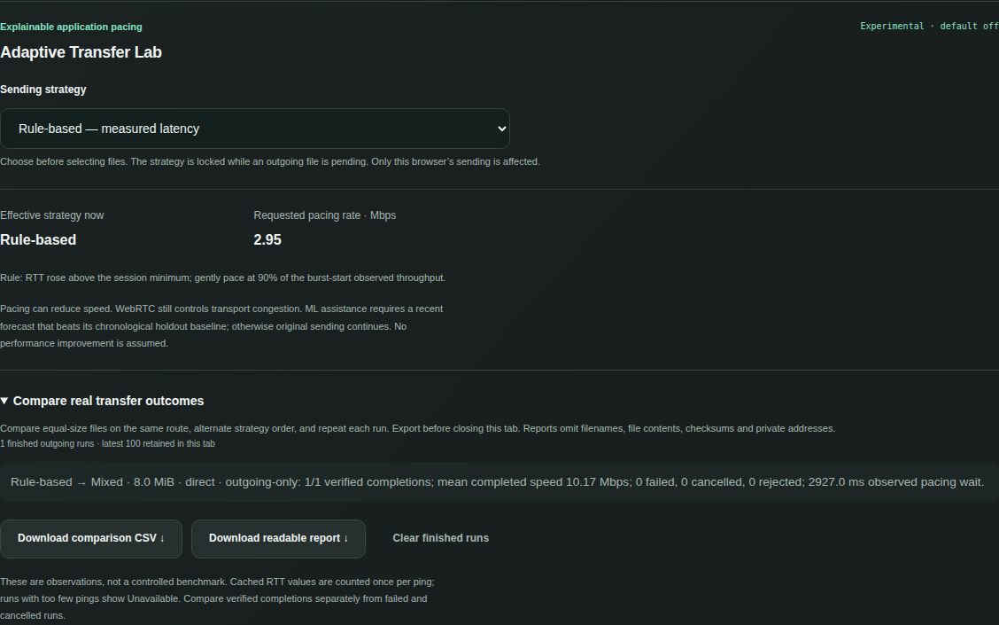

# LANFLUX technical report

## Project scope

LANFLUX is a Python-backed, browser-to-browser file-sharing application with experimental network intelligence. Two devices pair through a temporary room, approve each file, transfer encrypted WebRTC payloads and verify SHA-256 before downloading. A separate, access-controlled metadata path learns network behavior using IsolationForest and RandomForestRegressor. The application remains useful when ML is collecting data or unavailable.

This report explains the implementation, reproducible operation, security model and observed verification. It is suitable for a Computer Networks and AI/ML project review. It contains no fabricated benchmark dataset, accuracy claim or screenshot. The current code extends published version 0.3.0; the report is not a claim that a new versioned release or public service has been provisioned.

## Executive overview

| Concern | Implemented approach |
| --- | --- |
| Pairing | Unpredictable temporary two-peer rooms; matching QR/copy/display invitations; automatic query-link joining |
| Data transport | Reliable ordered WebRTC DataChannel with explicit approval, sequential queues, chunk limits and backpressure |
| Integrity | Incremental SHA-256 of original and received bytes; exact length validation before a download is offered |
| Discovery and fallback | Native ICE, optional STUN and secured TURN alternatives; actual selected-route diagnostics |
| Network visibility | Observed payload counters, monotonic timing, ping/pong RTT, bounded speed history and failure states |
| Unsupervised ML | Session-specific IsolationForest, real baseline collection, later signed anomaly scores |
| Supervised ML | Past-only RandomForest three-second throughput forecast, actual future labels and purged chronological validation |
| Interpretation | Explicit advisory rules combining fresh forecasts and anomaly observations; optional bounded, explainable application pacing with baseline fallback |
| Deployment | Local loopback default; explicit LAN mode; documented HTTPS/WSS reverse proxy and external coturn configuration |

## Real interface evidence


The homepage and sharing screenshots were refreshed on 22 October 2026 in real Chromium application scenarios. The complete capture manifest is in [the screenshot gallery](screenshots/README.md). Room capabilities and invitation addresses are masked where present. Narrow-screen images demonstrate viewport responsiveness, not a physical-device certification.


The AI panel shows an actual controlled loopback WebRTC transfer with test-only sender pacing. Displayed values were produced by observations and fitted models. They demonstrate the implemented pipeline; they are not representative Wi-Fi performance, labeled anomaly accuracy or proof that RandomForest improves network speed. The controlled workload pacing is test-only; the separately implemented Adaptive Transfer Lab is optional and defaults to baseline.


The successful transfer image reflects real received and verified bytes. The mobile view is emulated Chromium; it does not establish current physical-phone or Safari compatibility.

## Adaptive networking contribution

The current extension adds explainable application pacing and a local comparison of three strategies. Only baseline observations train the models; paced and unknown-policy windows are excluded. The selected strategy, effective intervention, actual delay and verified outcome are recorded separately. Short bounded interventions and recovery intervals address controller feedback without replacing WebRTC congestion control.

Read [the adaptive experiment methodology](ADAPTIVE_EXPERIMENTS.md) and [the competition brief](COMPETITION_BRIEF.md) for the hypothesis, repeated trials, interpretation and secure recovery prerequisites. The brief distinguishes shipped capabilities from future work. Funding success, universal novelty and faster transfers are not claimed.



The adaptive capture is a controlled browser workload with delayed actual pong replies. It records measured latency and optional pacing while preserving verified file bytes. It is not a real-world performance improvement claim.

## How to read this report

The subsequent chapters reproduce the maintained repository guides: user operation; system architecture and transfer protocol; AI algorithms and evaluation; security; configuration; public deployment; network experiments; and executed verification. The Markdown guides are the canonical source. Changes to those guides should be followed by a PDF rebuild.

## Engineering conclusions and future work

The working system separates transport, signaling and metadata analysis. File sharing depends on browser connection and receiver consent, while optional ML can remain collecting or unavailable without blocking it. Integrity checks and observed route labels make successful transfers auditable without pretending to verify the sender's real identity.

The current implementation deliberately keeps a bounded in-memory MVP. Future improvements require their own implementation and evidence:

- Streaming-to-disk on browsers with a suitable file API, with a safe fallback elsewhere.
- Safely resumable transfers with explicit protocol/version and retained-state design.
- More physical mobile devices and Safari/Firefox regression coverage.
- Longer, independently collected network sessions and labeled anomaly evaluation.
- A truly separate out-of-session test set for throughput forecasting and comparison against stronger baselines.
- Physical-network comparison of the implemented baseline, rule-based and ML-assisted pacing strategies; no general benefit is established yet.
- Shared room/session infrastructure before any multi-worker or multi-instance scaling.
- Operational relay-secret rotation, public access controls and approved campus deployment validation.

These are proposed extensions, not current capabilities or promised performance improvements.

## Terms and units

| Term | Meaning in LANFLUX |
| --- | --- |
| Signaling | Room admission and SDP/ICE exchange used to establish the browser connection |
| ICE | Browser connectivity checks selecting a permitted candidate pair |
| STUN | Discovery of mapped connection addresses; does not relay file payload |
| TURN | External relay for encrypted WebRTC traffic when a suitable direct route is unavailable |
| DataChannel | Ordered, reliable browser-to-browser message transport used for control and file chunks |
| RTT | DataChannel ping/pong elapsed time, including browser scheduling and channel queueing |
| MiB | Binary file-size unit: 1,048,576 bytes |
| MB/s | Decimal payload rate: 1,000,000 bytes per second |
| Mbps | Decimal payload rate: 1,000,000 bits per second; eight times decimal MB/s |
| SHA-256 | 256-bit digest used to compare original and received file bytes |
| IsolationForest | Unsupervised model identifying observations unusual relative to its collected baseline |
| RandomForestRegressor | Supervised ensemble predicting an approximate future measured payload rate |
| MAE | Mean absolute prediction error in Mbps; lower is better on the stated validation observations |
| Baseline | A defined comparison: collected observations for IsolationForest, or last measured speed for forecast error |
| Capability | A secret possession-based room identifier; it does not establish a person's real-world identity |

## Rebuild the report

The final PDF is committed at `docs/LANFLUX_Technical_Report.pdf`. The generator reads these Markdown guides and embeds the real screenshots; no external AI service or document upload is used.

```bash
python -m pip install -r requirements-report.txt
python scripts/build_report.py
```

The builder needs Python 3.10+ and ReportLab. It uses bundled ReportLab fonts for portability, with no application dependency changes. The result includes a contents page, chapter bookmarks, links and numbered pages. For visual verification, render it with Poppler:

```bash
pdftoppm -r 80 -png docs/LANFLUX_Technical_Report.pdf output/report-review/page
```

Create `output/report-review` first. Generated previews are ignored and should not be committed. The PDF is documentation, not a model artifact; models, observations, secrets and received files remain excluded from the repository.

## Technical references

The implementation source and tests are primary evidence for LANFLUX-specific behavior. The following official references explain its underlying technologies; they are not benchmark or compatibility certifications.

- [W3C WebRTC API specification](https://www.w3.org/TR/webrtc/): peer connections, ICE configuration, SCTP capabilities, statistics and DataChannel buffer APIs.
- [IETF RFC 8831: WebRTC Data Channels](https://www.rfc-editor.org/info/rfc8831/): non-media peer data transport using SCTP in WebRTC.
- [scikit-learn IsolationForest](https://scikit-learn.org/stable/modules/generated/sklearn.ensemble.IsolationForest.html): unsupervised isolation model, decision function and constructor parameters.
- [scikit-learn RandomForestRegressor](https://scikit-learn.org/stable/modules/generated/sklearn.ensemble.RandomForestRegressor.html): supervised tree ensemble and bounded fitting parameters.
- [FastAPI documentation](https://fastapi.tiangolo.com/): Python HTTP/WebSocket application framework.
- [coturn REST authentication](https://github.com/coturn/coturn/blob/master/README.turnserver#turn-rest-api): timestamped usernames and HMAC relay credentials.
- [Nginx WebSocket proxying](https://nginx.org/en/docs/http/websocket.html): explicit protocol-upgrade forwarding.

Runtime dependencies are declared in `requirements.txt`; tests in `requirements-dev.txt` and `package.json`; optional report generation in `requirements-report.txt`. Library versions may change within declared ranges. Reproduce an evaluation with recorded installed versions and the exact Git commit rather than assuming every dependency resolution is identical.
